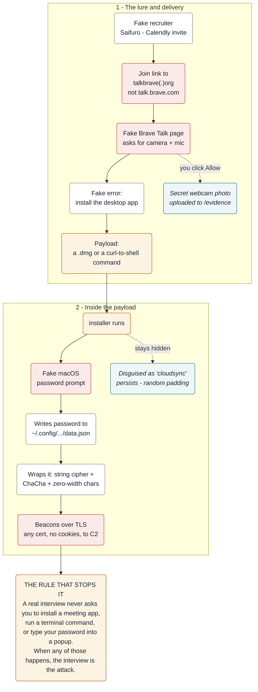

# Fake interview, real malware: a macOS infostealer teardown

On 2026-11-03 a recruiter booked me for a product interview. The "meeting link" tried to install
a macOS infostealer on my laptop. I did not run it. I copied the files to an isolated, offline VM
and took them apart with Ghidra and radare2. This is what was inside.

It is a "Contagious Interview" attack, the North-Korea-linked campaign that goes after people job
hunting in crypto, fintech and payments. I am publishing the teardown so others can recognise it and
detect it. The live binary is not in this repo; it is referenced by hash in [`SAMPLES.md`](SAMPLES.md).
The web scripts are included with their domains defanged. Do not run anything here.

## The setup

The company was "Saifuro", pitched as an AI-agent-payments startup: a believable site, 22 open roles,
a Calendly booking. Fifteen minutes before the call, the reminder emailed a link to join. It pointed
at `talkbrave[.]org`, a copy of Brave's real `talk.brave.com`, sitting behind Cloudflare.

The page asked for camera and microphone, like any video call. The moment you allow it, it draws a
webcam frame to a canvas and uploads the JPEG to `/evidence`. Then it shows an error saying you need
the "Brave Talk desktop app", with a `.dmg` to download and a Terminal command to paste. Both fetch
and run the same binary. The download link is one-time and cloaked: it serves the payload to the
targeted session and returns 404 to everyone else, which keeps it away from scanners.

## The payload

The binary is a universal (arm64 + x86_64) Mach-O that identifies itself internally as `cloudsync`.
Decompiled, it does four things:

- Shows a dialog that imitates the macOS password prompt and writes whatever you type to a file
  named `data.json` under a `.config` directory.
- Packages what it steals in three wrappers: a custom string cipher, a ChaCha-encrypted body, and
  zero-width Unicode characters.
- Sends it to a command-and-control server over a TLS session that accepts any certificate and sends
  no cookies, so a throwaway server with a self-signed cert works and the traffic looks unremarkable.
- Runs under a "cloudsync" name, holds a single-instance lock, persists, and pads itself with random
  bytes so its file hash keeps changing.

## What is worth noticing

There is no exploit. No zero-day, no memory corruption, nothing that breaks macOS. The whole attack
is a convincing interview plus a dialog box, and it lands on careful people because it arrives as
their next job. A few details show the work that went in:

- Typosquatting a product you already trust (`talkbrave[.]org` for `talk.brave.com`), with Cloudflare
  lending it a padlock and hiding the origin.
- Photographing the candidate before any malware runs, which gives the operator proof of a real
  person and material for later impersonation.
- Two delivery paths from one page: a `.dmg` for the cautious, a `curl | sh` for the technical.
- Compile-time string obfuscation instead of a runtime packer. It is only XOR, but it is enough to
  beat a quick `strings` pass, and the real secrets sit under two more layers.

## Reverse engineering

- [`analysis/deobfuscation.md`](analysis/deobfuscation.md): the string cipher, the 32-byte key, and
  worked examples.
- [`analysis/decode_strings.py`](analysis/decode_strings.py): a short decoder that reverses it. It
  recovers the hidden config, for example `.config` and `data.json`.
- [`analysis/decompiled/`](analysis/decompiled/): Ghidra pseudocode for the cipher, the password
  capture, the JSON builder, and the certificate-ignoring network session.
- [`report/forensic-report.md`](report/forensic-report.md): the full report, with the kill chain,
  capability analysis, MITRE ATT&CK mapping, attribution, IOCs and remediation.

The runtime C2 address uses a second string class that I did not crack, and it probably lives in the
`cshelper` binary inside the DMG, which the disk image would not give up on Linux. So the literal
server address is still encrypted. Everything else here is recovered or observed directly.

## Attribution

I assess this at roughly 80% match to the DPRK "Contagious Interview" playbook (tracked as Famous
Chollima and BlueNoroff): fake recruiter, fake meeting app, fake password prompt, credential and
crypto theft. The one thing that cuts against it is Russian-language comments in the web code. This
is not courtroom-grade from static evidence alone, and the full reasoning is in the report.

## If this happened to you

If you only opened the page, revoke its camera and microphone access, clear its site data, and delete
any download. A webcam photo and a microphone event may have gone out, but nothing ran. If you pasted
the command, opened the DMG, or typed your password into the dialog, treat the machine as compromised:
from a different device, change your Mac, Apple ID, email, work SSO and exchange passwords, revoke
active sessions, and move any crypto using a seed on a clean machine.

To hunt for it, block the domains in [`iocs/iocs.md`](iocs/iocs.md) and run the YARA rule in
[`iocs/saifuro_bravetalk.yar`](iocs/saifuro_bravetalk.yar).

## Method and credits

Caught and reverse-engineered by [Alisher Ataev](https://www.linkedin.com/in/alisherataev). Static
analysis only, on an isolated VM with outbound traffic blocked. No sample was executed at any point.
